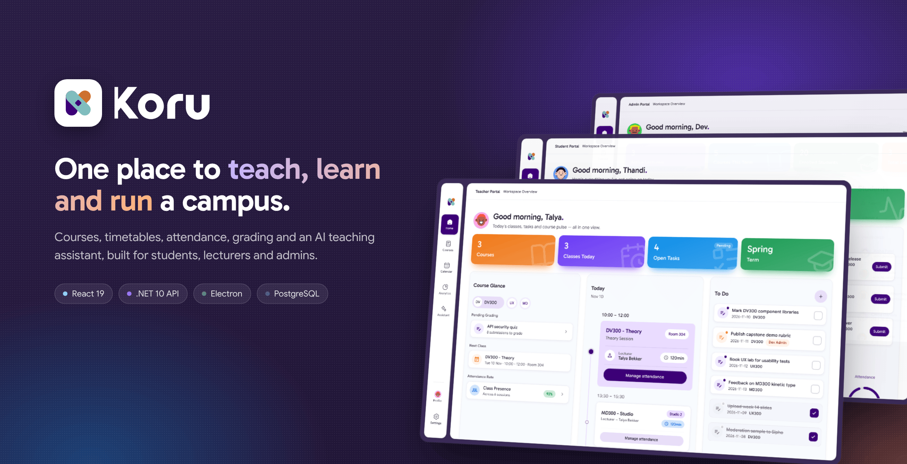

# Koru

**A cross-platform desktop learning management system for students, lecturers and administrators.**

Built by Chloe Robinson, Danae Swart, Rikus Pretorius and Victor du Preez · Version 2.0 · November 2026

         

<details>
<summary><b>Table of contents</b></summary>

1. [About the project](#about-the-project)
2. [What's new in version 2.0](#whats-new-in-version-20)
3. [Getting started](#getting-started)
4. [Features](#features)
5. [Development process](#development-process)
6. [Testing](#testing)
7. [Feedback and iteration](#feedback-and-iteration)
8. [Conclusion](#conclusion)
9. [Team, licence and acknowledgements](#team-licence-and-acknowledgements)

</details>

---

## About the project

Colleges often run teaching, scheduling, grading and administration on separate tools that don't talk to each other. Staff duplicate work, students miss deadlines and nobody gets a clear view of how a class is doing.

Koru brings all of it into one desktop app with a shared database. Students, lecturers and administrators each get a workspace built around their own work: courses, assignments, grading, attendance, timetables, analytics and an AI teaching assistant. It runs natively on Windows and macOS through Electron, and it is **POPIA-compliant by design**: it never stores South African ID numbers or dates of birth.

<p align="center">
  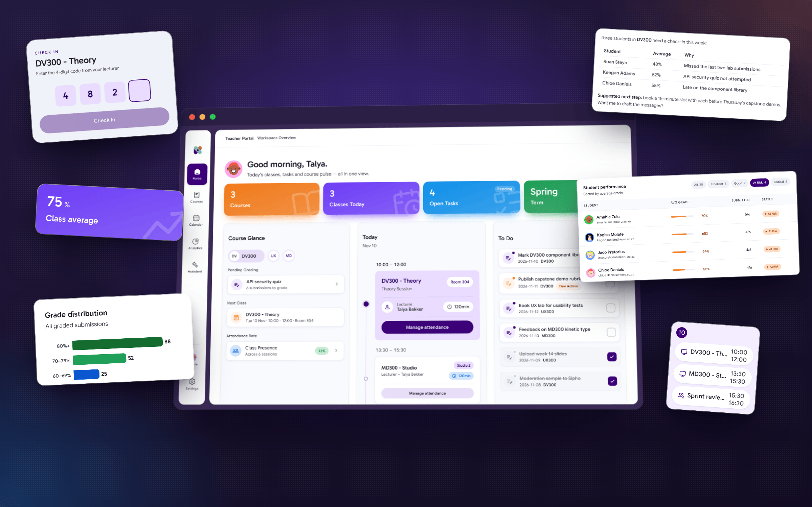
</p>

<p align="center">
  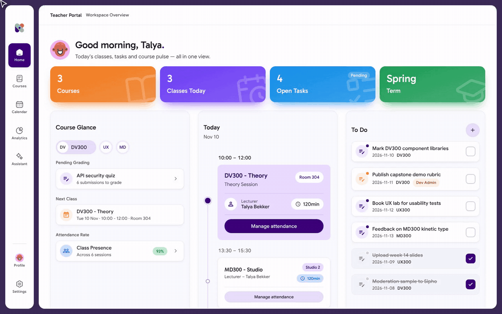
</p>

### Goals from the client brief

| Goal | How Koru meets it |
|---|---|
| One platform instead of many | A single PostgreSQL database behind every workflow |
| The right tools for each role | Separate student, lecturer and admin workspaces, routed by role |
| POPIA compliance | Only name, surname, student number, gender and email are stored |
| Desktop on Windows and macOS | React app packaged with Electron |
| An MVP within R250,000 and 12 weeks | Delivered in four sprints, then refined in version 2.0 |

### Built with

| Layer | Technology | Used for |
|---|---|---|
| Desktop | Electron 36 | Native window, packaging for Windows and macOS |
| Frontend | React 19, Vite 7, TypeScript, React Router 7 | Role-based interface and routing |
| Styling | Tailwind CSS 4 with the Koru design system (Material 3 patterns) | Consistent tokens and components across every page |
| Charts | MUI X Charts | Analytics dashboards |
| Motion and content | Framer Motion, Novel, jsPDF, Solar Icons | Transitions, rich-text notes, PDF export, icons |
| Backend | ASP.NET Core (.NET 10), Entity Framework Core 10 | REST API with 21 controllers, code-first migrations |
| Database | PostgreSQL (Npgsql provider) | Relational academic records |
| Security | BCrypt.Net-Next, Google sign-in, Otp.NET | Password hashing, single sign-on, two-factor codes |
| AI | DeepSeek, with Groq as a fallback | The teaching assistant |
| Tooling | Docker Compose, Swagger UI, ESLint, Jest, xUnit | Containerised API, API testing, linting, automated tests |

---

## What's new in version 2.0

Version 2.0 (November 2026) is a design and quality release. It acts on our [UX audit](ux_audit_report.md) and the lecturer feedback below, without changing how the app behaves.

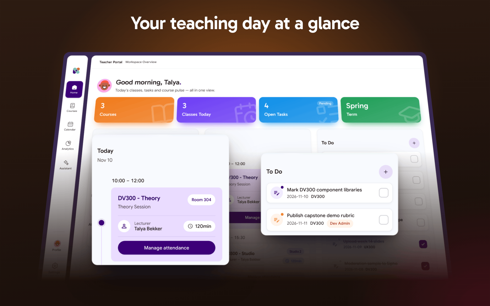 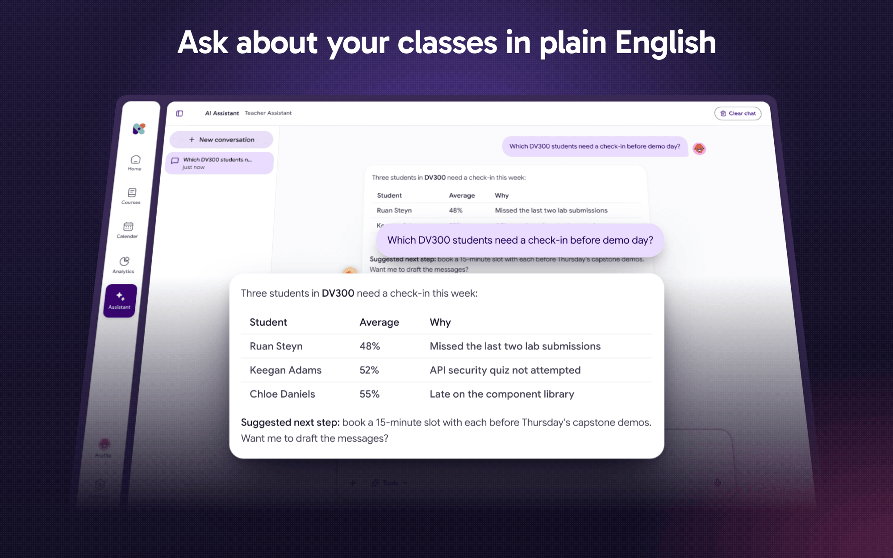

| Area | Version 1.0 (June 2026) | Version 2.0 (November 2026) |
|---|---|---|
| **Design system** | Mixed DaisyUI components and one-off styles | A Koru design system on Material 3 patterns: colour roles, type scale, shape, elevation and motion tokens, plus shared primitives (Button, Card, Input, Select, Alert, Badge, Modal, Avatar, Skeleton, EmptyState, PageHeader) |
| **Consistency** | Pages styled independently | **Every page migrated**: sign-in, app shell, all three dashboards, course views for each role, calendars and attendance, profile, settings, analytics and the assistant |
| **Look and feel** | Light pages on a plain background | A dark purple canvas with solid page shells, and a redesigned split-screen sign-in and sign-up flow |
| **People** | Initials in circles | Generated avatars for every user, shown through one shared `Avatar` component |
| **Analytics** | Hand-built graphs | Rebuilt on MUI X Charts through Koru wrappers, styled with the design tokens |
| **AI assistant** | One request, one reply | Streams its reply with visible progress, checks every answer against a JSON schema, and falls back from DeepSeek to Groq if the first provider fails |
| **AI keys** | Set in `appsettings.json` | Loaded from a local, git-ignored `.env` file |
| **Code structure** | `teacherCourses.jsx` at about 125 KB and 3,500 lines | Split into focused components; the page itself is now about 5 KB |

The design system is documented in [`Frontend/DESIGN_SYSTEM.md`](Frontend/DESIGN_SYSTEM.md). While the frontend runs in development, every token and primitive can be previewed at `http://localhost:5200/#/design-system`.

---

## Getting started

### Prerequisites

| Requirement | Version | Get it |
|---|---|---|
| .NET SDK | 10.0 | [dotnet.microsoft.com/download](https://dotnet.microsoft.com/download) |
| Node.js and npm | 20.19 or later | [nodejs.org](https://nodejs.org) |
| PostgreSQL | 14 or later, local or hosted | [postgresql.org/download](https://www.postgresql.org/download/) |
| Docker (optional) | Any recent version | [docker.com](https://www.docker.com/products/docker-desktop/) |
| AI keys (optional, for the assistant) | DeepSeek and/or Groq | [platform.deepseek.com](https://platform.deepseek.com) · [console.groq.com](https://console.groq.com) |

### 1. Clone the repository

```bash
git clone https://github.com/wrapperik/koru.git
cd koru
```

### 2. Configure the backend

Point the API at your PostgreSQL database and add the assistant keys in `Backend/LearnOnline/.env`. The file is git-ignored, and real environment variables always take precedence over it.

```bash
ConnectionStrings__LearnOnlineDb=Host=localhost;Port=5432;Database=koru;Username=postgres;Password=your-password
DEEPSEEK_API_KEY=your-deepseek-key
GROQ_API_KEY=your-groq-key
```

On start-up the API applies all migrations and seeds the database.

| Optional variable | What it does |
|---|---|
| `KORU_DB_GUARD=true` | Stops the API at start-up if the connection string is missing or points at the shared `defaultdb` database. Off unless set to `true`. |

### 3. Run the backend

```bash
cd Backend/LearnOnline
dotnet run
```

The API runs at `http://localhost:5299`, with Swagger UI at `http://localhost:5299/swagger`.

To run it in Docker instead, from the repository root:

```bash
docker compose up --build
```

### 4. Run the frontend

In a second terminal:

```bash
cd Frontend
npm install
npm run electron:dev
```

This starts Vite on `http://localhost:5200` and opens Koru in an Electron window. Use `npm run dev` to work in the browser only, or `npm run electron:build` to package the desktop app.

### 5. Run the tests

```bash
npm run test:backend              # from the repository root: xUnit
cd Frontend && npm test           # Jest and React Testing Library
```

---

## Features

### Students

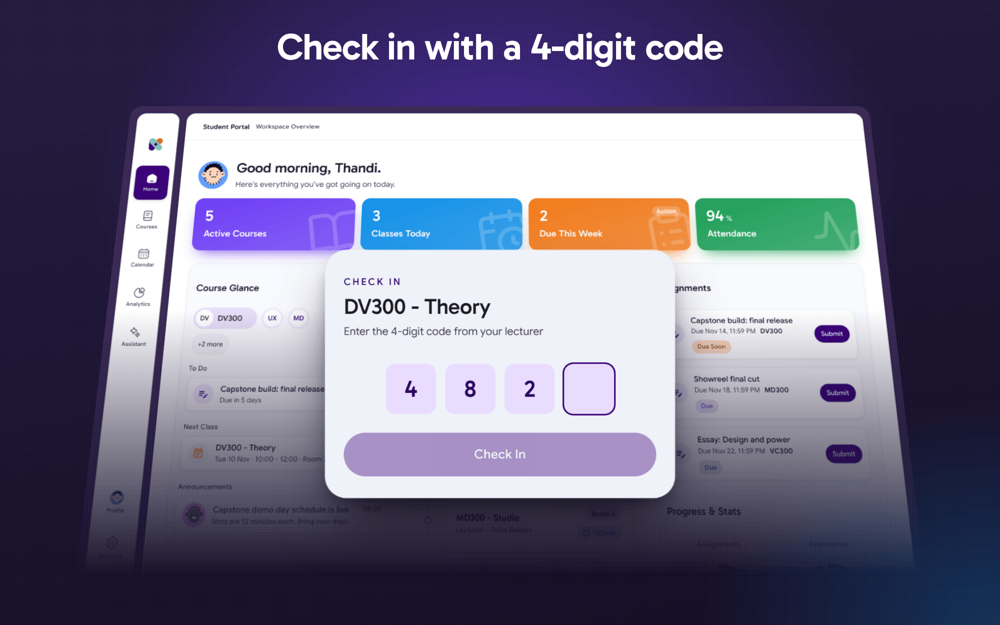 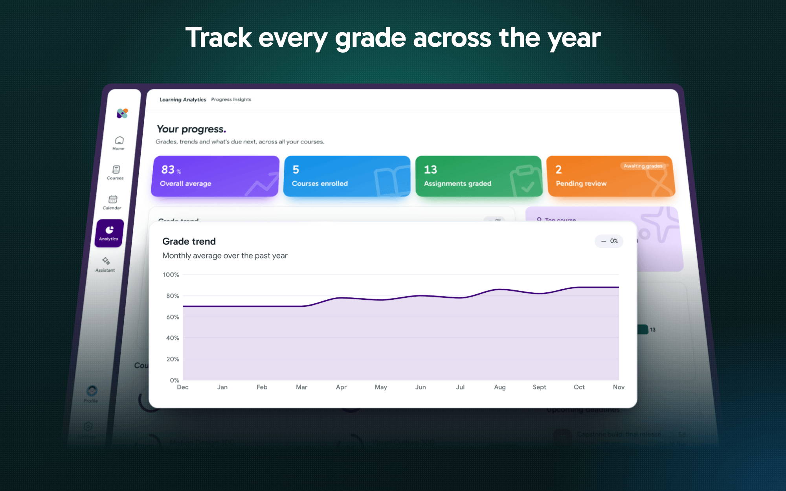

- A dashboard with today's classes, deadlines and course progress
- Course pages with modules, materials and announcements
- Assignment submission, grades and lecturer feedback
- Class check-in with a 4-digit code
- Grade trends and attendance across the year
- A personal calendar and rich-text notes

### Lecturers

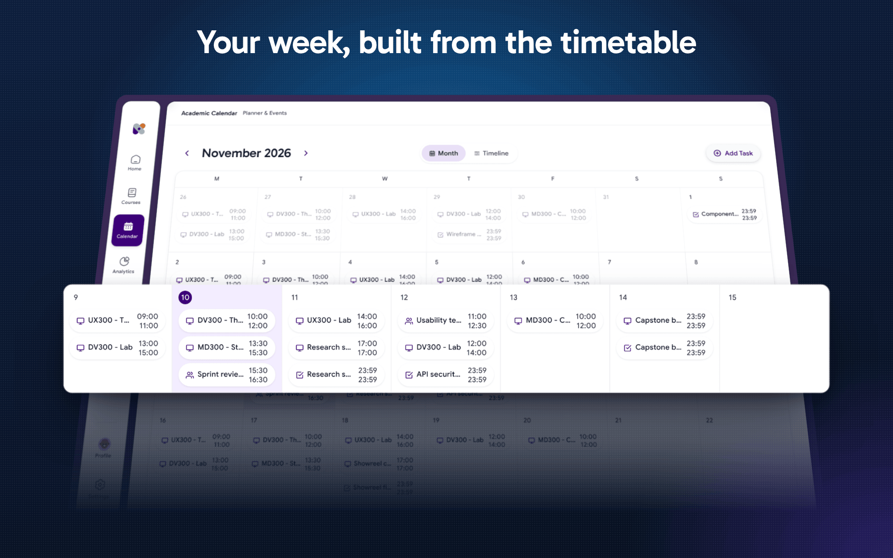 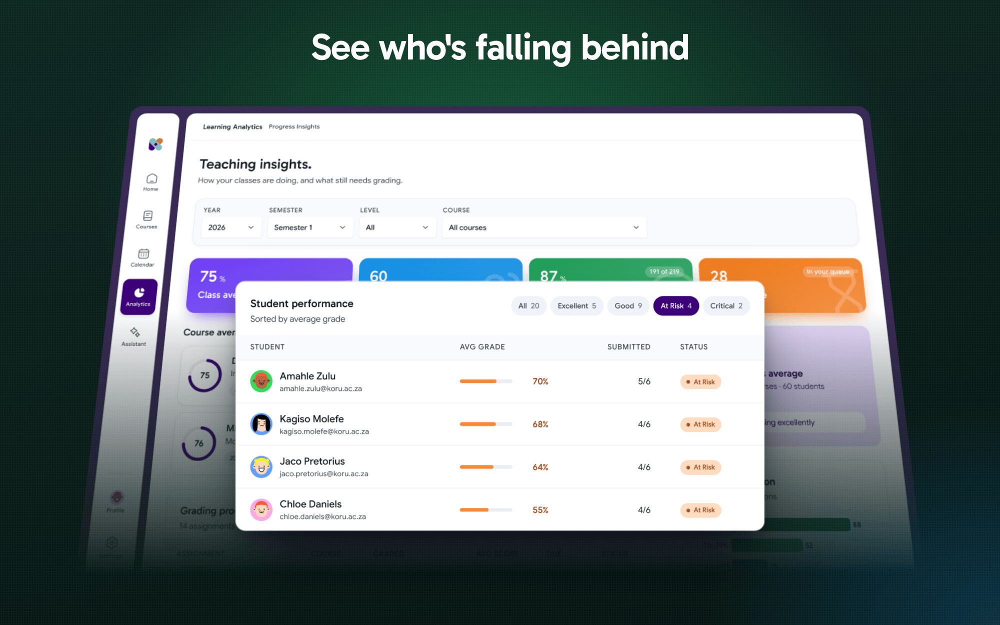

- A teaching day at a glance: today's classes, tasks and course pulse
- Course, module and assignment management, with due dates per class group
- Grading and feedback on submissions
- Attendance sessions and check-in codes
- Analytics: class averages, grade distribution and students at risk
- An AI assistant that answers questions about their classes in plain English
- A weekly calendar built from the timetable

### Administrators

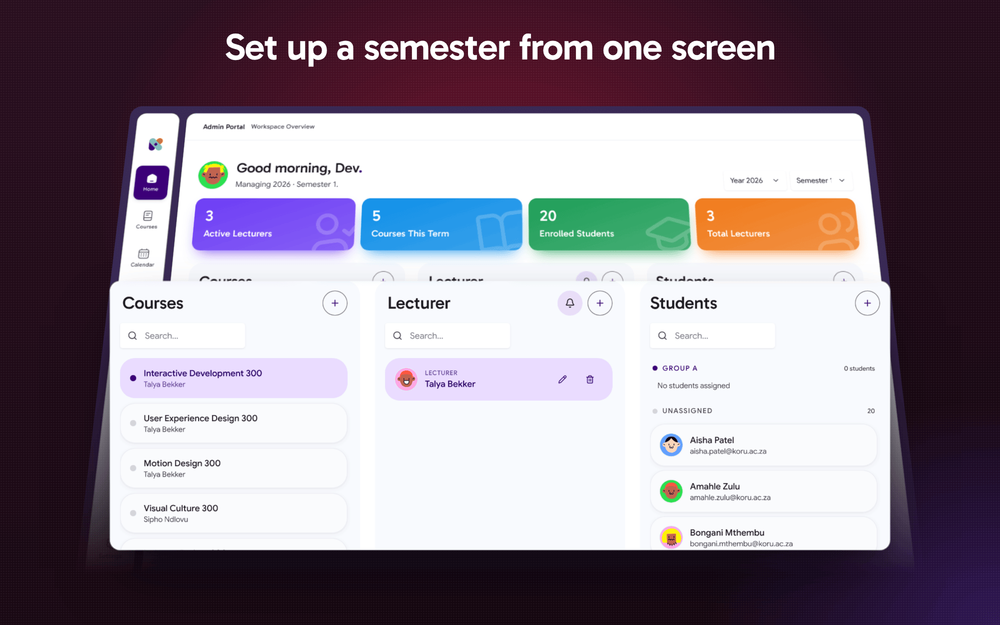 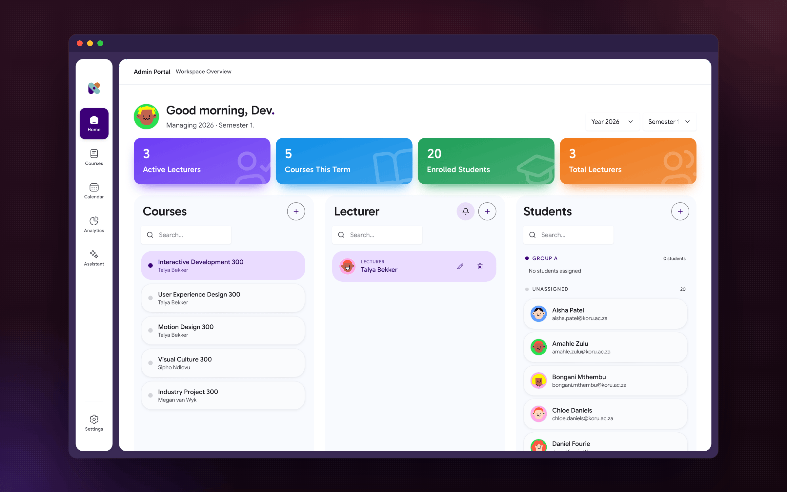

- Full user management for students, lecturers and admins
- Subjects, courses and class groups
- Semester set-up: assign lecturers and enrol students from one screen
- Institution-wide announcements, notifications and analytics

<details>
<summary><b>More screenshots</b></summary>
<br />

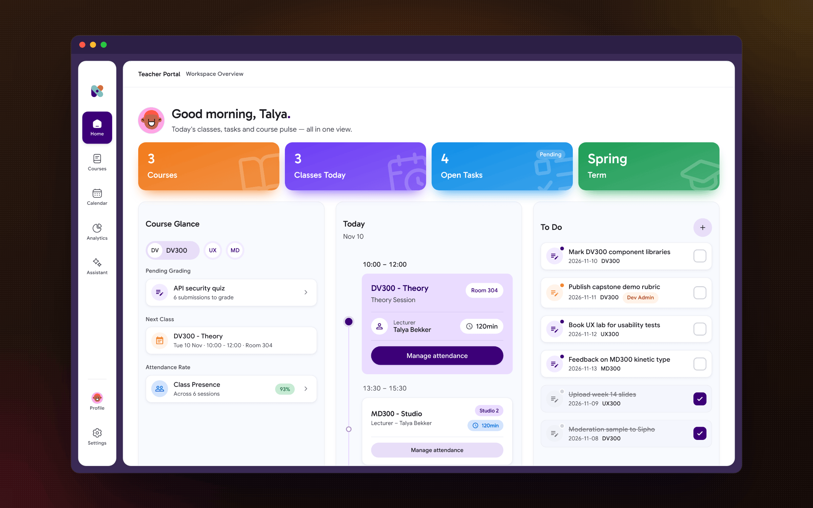 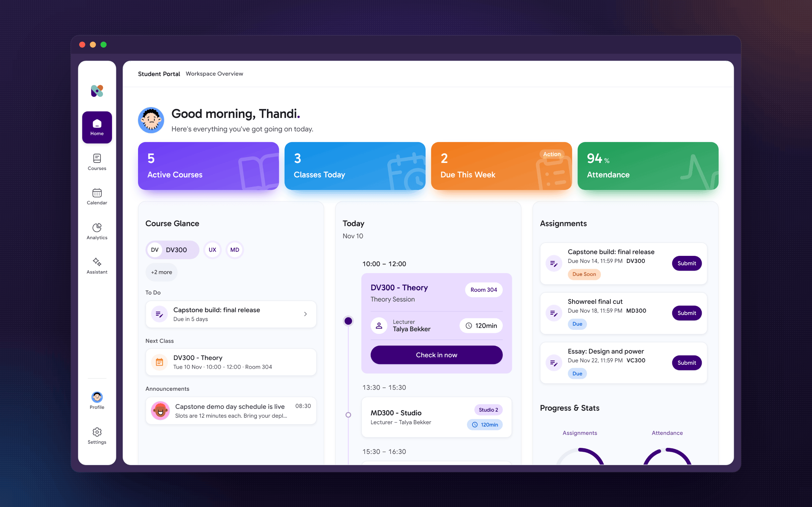
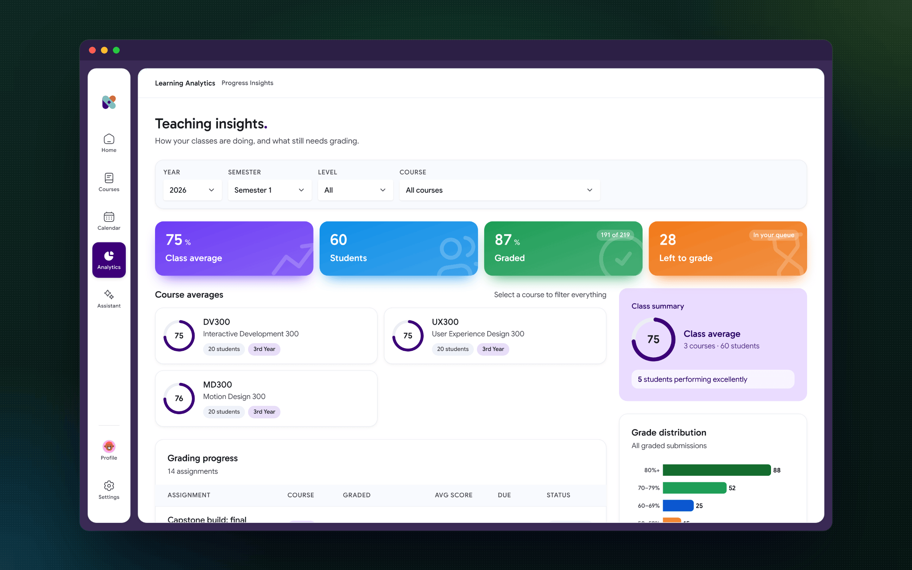 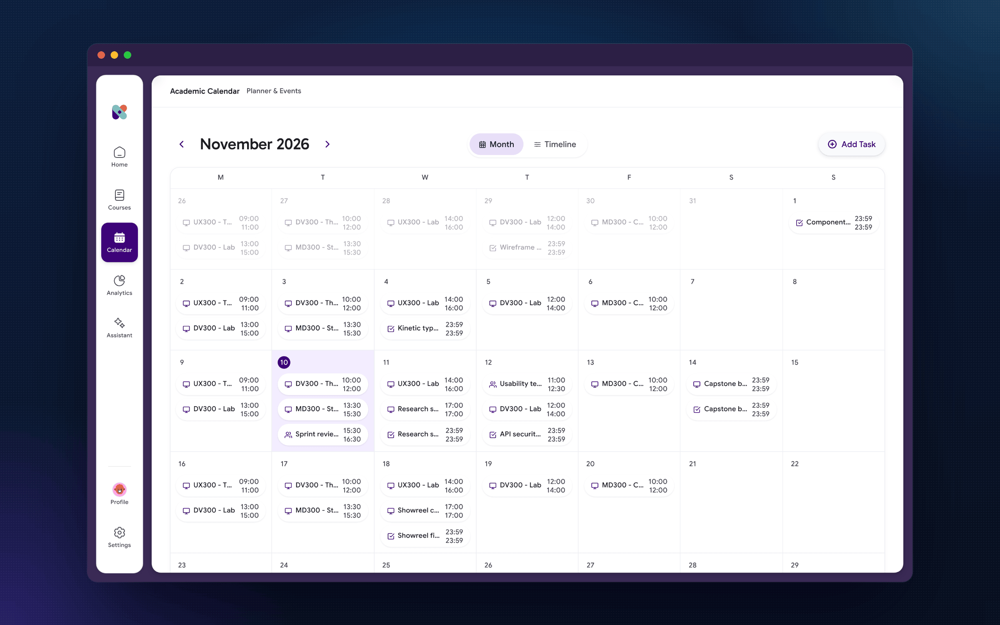
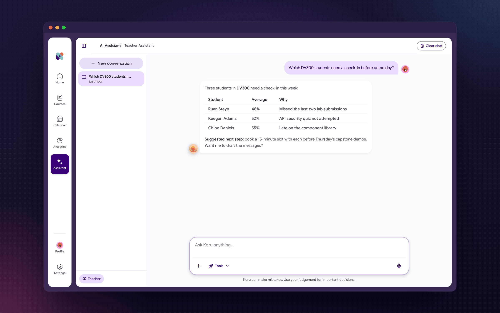

</details>

---

## Development process

### Team and roles


| Member | Responsibilities |
|---|---|
| **Chloe Robinson** | Sprint management, backlog, all documentation |
| **Danae Swart** | Integration testing, UI consistency, QA |
| **Rikus Pretorius** | React architecture, full UI/UX implementation, the version 2.0 design system |
| **Victor du Preez** | ASP.NET Core API, PostgreSQL, unit tests |

We worked in four sprints with a shared GitHub repository, feature branches and reviewed merges, and planned on WhatsApp and Discord. Backend and frontend were separate workstreams from day one, so they could progress in parallel.

### Architecture

Koru is a three-tier application: an Electron shell around the React frontend, talking to an ASP.NET Core API over REST.

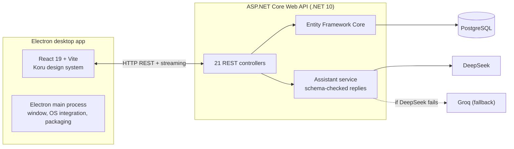

### Data model

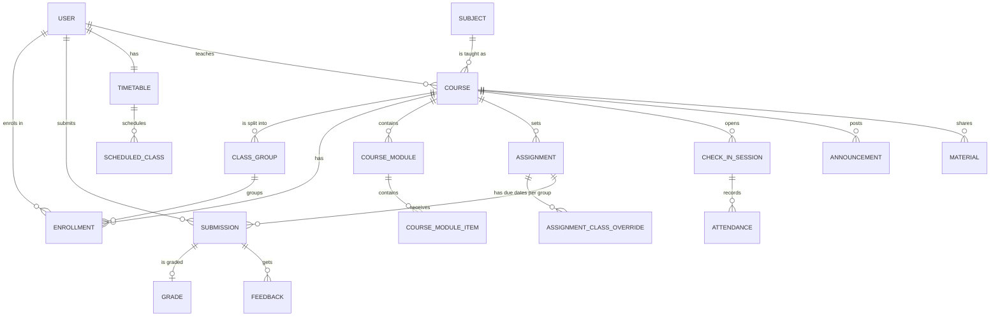

All three roles share one `Users` table with a role enum (student, teacher, admin), which keeps identity normalised. It stores only name, surname, student number, gender, email and a BCrypt-hashed password.

### Key API endpoints

| Area | Controllers |
|---|---|
| Identity | `User` (register, sign in, Google sign-in, two-factor, roles) |
| Catalogue | `Subject`, `Course`, `ClassGroup`, `Enrollment` |
| Content | `CourseModule`, `CourseModuleItem`, `Material`, `Announcement` |
| Assessment | `Assignment`, `Submission`, `Grade`, `Feedback` |
| Attendance | `Attendance`, `CheckIn` (open a session, check in with a code, mark students) |
| Scheduling | `Timetable`, `Class`, `Event`, `Todo` |
| Personal | `Note` |
| AI | `Assistant` (`POST /api/assistant/chat` and `/chat/stream`) |

The full API is documented in Swagger UI when the backend runs.

### Key decisions

- **Web first, then Electron.** We built the React app in the browser and wrapped it in Electron, which kept development fast and avoided Electron-specific problems early on.
- **Code-first migrations.** Entity Framework Core migrations keep the schema in version control alongside the code.
- **One users table with a role enum** instead of a table per role.
- **Due dates per class group.** The `AssignmentClassOverride` table lets one assignment have different open, due and close dates for different groups, a direct response to lecturer feedback.
- **A design system before more features.** In version 2.0 we stopped adding screens and moved every page onto shared tokens and primitives, so the three roles finally look like one product.
- **The AI never has the final say on data.** Assistant replies are checked against a schema before the app uses them, with a second provider as a fallback.

### Why these tools

- **Electron:** the brief required a desktop app for Windows and macOS. Electron packages our React code as a native app with its own window and taskbar presence, without a rewrite.
- **ASP.NET Core:** strong object-oriented structure, built-in dependency injection and first-class EF Core support suit an API with complex role-based access.
- **PostgreSQL:** strict types, foreign keys and enums protect academic record integrity and support the POPIA-compliant data model.
- **React and Vite:** a component model that scales with the app, and fast reloads during development.
- **TypeScript:** catches mismatches between frontend and backend data shapes before they reach users.
- **Tailwind CSS with our own design system:** Tailwind gives fast, consistent styling, and the version 2.0 tokens and primitives (following Material 3 patterns) keep every screen on the same visual language.

---

## Testing

| Suite | Tools | Location | Tests |
|---|---|---|---|
| Backend | xUnit, EF Core InMemory, Moq, FluentAssertions, Coverlet | `Backend/LearnOnline.Tests` | 173 (172 pass) |
| Frontend | Jest 30, React Testing Library, jsdom | `Frontend/tests` | 98 in 14 suites (all pass) |
| Manual | Swagger UI, packaged Electron builds | — | All controllers; Windows and macOS |

*Last run on 8 November 2026. One backend test, `ClassControllerTests.GetAll_IncludesNavs`, currently fails and is being fixed.*

The backend suite covers every controller's create, read, update and delete paths, plus the sign-in and Google flows. The frontend suite covers the API services, `AuthContext`, `ProtectedRoute` and shared components.

**Coverage (version 1.0 report, June 2026)**

| | Lines | Branches |
|---|---|---|
| Backend | 83.3% (1,019 of 1,222) | 76.4% (133 of 174) |
| Frontend | 84.8% (178 of 210) | 57.7% (112 of 194) |


The riskiest method was `UserController.GoogleAuth()` (cyclomatic complexity 22), which needs more branch tests. `CourseModuleController` and `CourseModuleItemController` were tested manually in Swagger UI but have no automated tests yet.

<details>
<summary><b>Generating the coverage reports</b></summary>

```bash
# Backend (one-time: dotnet tool install -g dotnet-reportgenerator-globaltool)
npm run test:backend:coverage
# then open reports/backend/html/index.html

# Frontend
cd Frontend && npm run test:coverage
# then open reports/frontend/index.html
```

</details>

---

## Feedback and iteration

We showed an early build to our UX lecturer and acted on three points.

| Feedback | What we changed |
|---|---|
| **No clear visual hierarchy.** Everything on the dashboards had the same weight. | Rebuilt all three dashboards on a three-column grid, added a shared top bar with breadcrumbs and a role badge, and introduced a consistent card system. Version 2.0 takes this further with the full design system. |
| **Too complicated.** Too much on screen at once. | Split the 3,500-line `teacherCourses.jsx` into focused views, so lecturers see one task at a time, and used staggered entrance animations to guide attention. |
| **Different classes need different due dates.** | Added open, due and close dates per assignment, per class group, in both the data model and the assignment drawer, and plotted due work on the student's day timeline. |

---

## Conclusion

### Highlights

- A complete LMS for three roles, running natively on Windows and macOS
- 21 REST controllers over a normalised, POPIA-compliant PostgreSQL database
- A version 2.0 design system that brings every page onto one visual language
- An AI assistant with streaming, schema-checked replies and a fallback provider
- 271 automated tests across the stack

### Challenges

- **Electron packaging:** getting the packaged app to behave the same on Windows and macOS took dedicated iteration.
- **Component size:** `teacherCourses.jsx` grew to 125 KB before we broke it apart; merge conflicts in that file cost us time.
- **Three roles, one product:** role views drifted apart in structure and style until the version 2.0 design system unified them.
- **POPIA by design:** keeping ID numbers and dates of birth out of every form and table needed constant attention.
- **The assessment pipeline:** modelling assignments, submissions, grades and feedback took several rounds of migrations.

### Future improvements

- Share one base calendar between the student, lecturer and admin calendars
- Replace the remaining browser `alert()` and `confirm()` dialogs with design-system dialogs and toasts
- Desktop notifications, a system tray icon and auto-updates through Electron
- CI that runs both test suites and builds the Electron app for both platforms before every merge
- Pagination and virtual scrolling for large admin and analytics tables
- Discussion boards, plagiarism checks and CSV or PDF grade exports

### What we learned

- Delivering a full-stack product against a real client brief, as a team of four
- Splitting work cleanly between frontend and backend so neither blocked the other
- Packaging and testing a desktop app across two operating systems
- Building privacy into the data model rather than adding it later
- Turning feedback into concrete changes, and why a design system pays off as an app grows

The full project report is on [Google Docs](https://docs.google.com/document/d/18CDNf5jPBDjGq7J_sfvUBfOsw2AmLEYMO7007erZ_zI/edit?usp=sharing).

---

## Team, licence and acknowledgements

### Authors

| Name | GitHub |
|---|---|
| Chloe Robinson | [@corbyn-jpg](https://github.com/corbyn-jpg) |
| Danae Swart | [@danaeswart](https://github.com/danaeswart) |
| Rikus Pretorius | [@wrapperik](https://github.com/wrapperik) |
| Victor du Preez | [@victordupreez0](https://github.com/victordupreez0) |

Created at Open Window, 2026.

### Licence

No open-source licence applies. © 2026 the Koru team. All rights reserved: the code may not be reproduced, distributed or used to create derivative works without permission.

### Acknowledgements

- [React](https://react.dev), [Vite](https://vite.dev), [Electron](https://www.electronjs.org), [Tailwind CSS](https://tailwindcss.com), [MUI X Charts](https://mui.com/x/react-charts/), [Framer Motion](https://motion.dev), [Novel](https://novel.sh), [jsPDF](https://github.com/parallax/jsPDF)
- [ASP.NET Core](https://learn.microsoft.com/aspnet/core), [Entity Framework Core](https://learn.microsoft.com/ef/core), [Npgsql](https://www.npgsql.org), [BCrypt.Net-Next](https://github.com/BcryptNet/bcrypt.net), [Otp.NET](https://github.com/kspearrin/Otp.NET), [Swashbuckle](https://github.com/domaindrivendev/Swashbuckle.AspNetCore)
- [Material 3](https://m3.material.io) design guidance, [Solar Icons](https://solar-icons.vercel.app), [DiceBear](https://www.dicebear.com) avatars, and the Gabarito and Google Sans typefaces
- [DeepSeek](https://www.deepseek.com) and [Groq](https://groq.com), which power the in-app assistant
- AI coding assistants, including Claude Code, used for parts of the version 2.0 design-system migration and the assistant rework
- Our UX lecturer at Open Window, for the feedback that shaped this release
